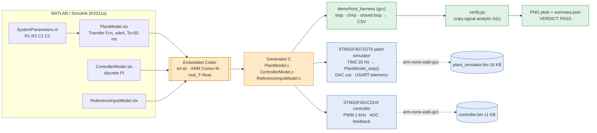
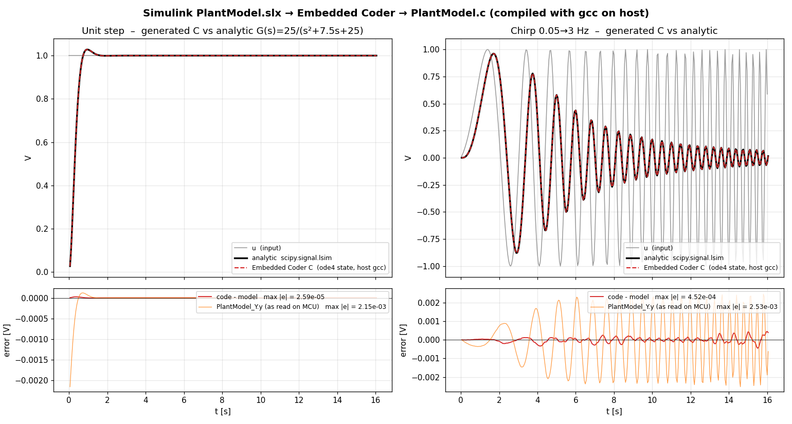
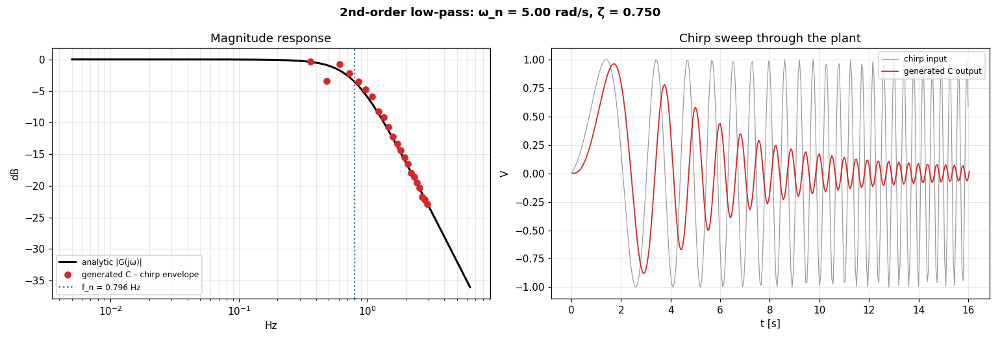
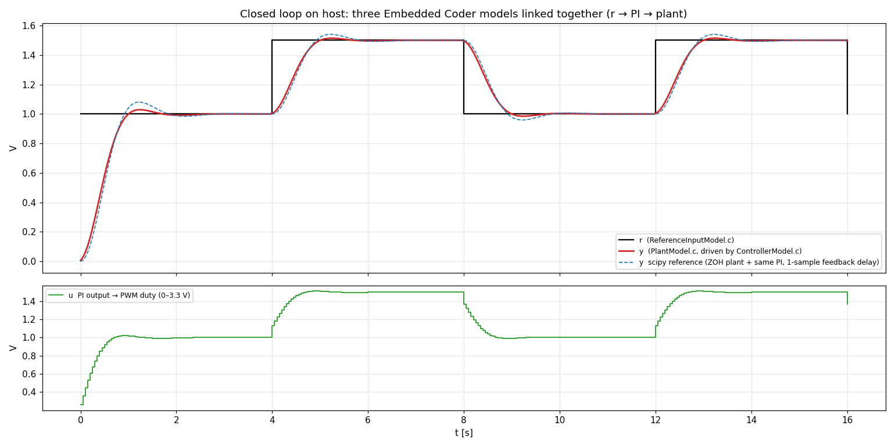

# Demo — Stage 2: Simulink → Embedded Coder → C, proven against the model

Single entry point:

```bash
sudo apt-get install -y gcc python3-numpy python3-scipy python3-matplotlib   # host
sudo apt-get install -y gcc-arm-none-eabi binutils-arm-none-eabi libnewlib-arm-none-eabi  # optional: STM32 cross-compile
./demo/run_demo.sh            # ~3 s, writes everything to demo/out/
SKIP_ARM=1 ./demo/run_demo.sh # host-only
```

## What runs where

| Piece | Source | Real or simulated? |
|---|---|---|
| Plant model `G(s) = 25/(s²+7.5s+25)` (2nd-order Butterworth LPF, Sallen-Key values from `Simulink/SystemParameters.m`) | `Simulink/PlantModel.slx` | Real model — code was generated from it with Embedded Coder R2021a (`ert.tlc`, ARM Cortex-M, ode4, 50 ms) |
| `plant_simulator/SimulinkModels/PlantModel/PlantModel.c` | **unmodified generated code** | **Executed on host** by `host_harness/main.c` (gcc). Same `PlantModel_initialize()` / `PlantModel_step()` the STM32F407 calls from `HAL_TIM_PeriodElapsedCallback` |
| `controller/SimulinkModels/ControllerModel.c`, `ReferenceInputModel.c` | **unmodified generated code** | **Executed on host** in the `closedloop` scenario (PI controller + pulse reference) |
| Analytic reference | `scipy.signal.lsim` / `bode` of the same transfer function | Host, pure math — the oracle the generated code is checked against |
| STM32F407 plant-simulator firmware, STM32F401 controller firmware | `plant_simulator/`, `controller/` (CubeMX HAL, startup, linker scripts) | **Cross-compiled with `arm-none-eabi-gcc`** into `.elf`/`.bin` (see `out/firmware_build.txt`). **Not executed** — no board attached; DAC/ADC/PWM/USART I/O is replaced by CSV on host |

Nothing is mocked: the harness links the generated sources directly, and the firmware build uses the real HAL that ships in this repo.
The only glue added is `demo/host_harness/main.c` (a loop that feeds `PlantModel_U.u` and reads `PlantModel_Y.y`) and two Makefiles.

## Architecture



## Verification results (`out/verify_report.txt`)

```
Plant  G(s) = 25.0 / (s^2 + 7.50 s + 25.0)   wn = 5.00 rad/s  zeta = 0.750   Ts = 50 ms  ode4
step    max|code-model| = 2.59e-05 V   rms = 4.00e-06 V   (MCU-read Y: 2.15e-03 V)
chirp   max|code-model| = 4.52e-04 V   rms = 1.43e-04 V   (MCU-read Y: 2.53e-03 V)
closed  steady-state error = 5.50e-05 V
tolerance 1e-03 V  ->  VERDICT: PASS
```

Two columns are logged for the plant output:

* `y_rk4` — `25·x₂` rebuilt from the integrated continuous state after `PlantModel_step()`, i.e. the exact ode4 estimate of `y(t+Ts)`. This is the "code = model" number (≤ 4.5e-4 V, dominated by RK4 truncation at 3 Hz where `h·ω ≈ 0.94`, and float32 `real_T`).
* `y` — `PlantModel_Y.y` exactly as the STM32 reads it after the step. ERT evaluates the outport before the ode4 update, then the minor-step calls overwrite it with the RK4 stage-4 predictor, so it carries a ~2 mV (0.2 %) transient bias. Worth knowing when you compare DAC telemetry against Simulink in Stage 3.





## Files

```
demo/
├── run_demo.sh            single entrypoint
├── verify.py              scipy oracle + plots + PASS/FAIL (exit code)
├── host_harness/          main.c + Makefile → build/harness  (gcc)
├── firmware/Makefile      arm-none-eabi build of plant_simulator / controller (CubeMX layout, no IDE)
├── TALK_TRACK.md
└── out/                   PNGs, summary.json, verify_report.txt, firmware_build.txt (CSV/ELF ignored)
```
